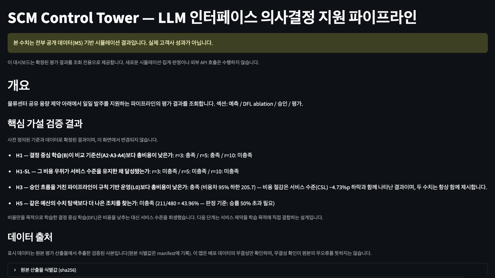
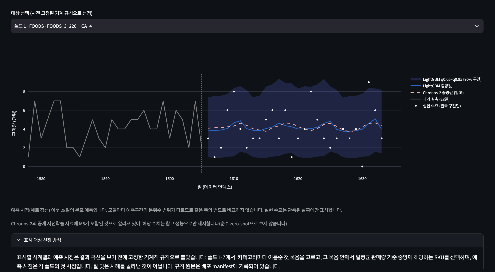

# SCM Control Tower — LLM 인터페이스 의사결정 지원 파이프라인

물류센터(DC) 공유 용량 제약 아래에서 **일일 발주 의사결정**을 지원하는 파이프라인입니다. 확률 수요 예측, 결정 중심 학습(Decision-Focused Learning), 후보 조치의 자동 검증 게이트, 사람의 승인 흐름을 하나의 평가 체계로 연결하고, 사전 정의된 가설과 기준으로 성과를 검증했습니다.

> 본 저장소의 모든 수치는 공개 데이터(M5) 기반 **시뮬레이션 결과**이며, 실제 고객사 성과가 아닙니다.

**대시보드**: https://control-tower-agent.streamlit.app · 로컬 실행: `cd dashboard && streamlit run app.py`

## 대시보드에서 볼 수 있는 것

| 섹션 | 내용 |
|---|---|
| 개요 | 핵심 가설 4종의 검증 결과와 데이터 출처(원본 산출물 식별값) |
| 예측 | 모델별 예측 품질(WQL·WAPE·MASE), 예측구간의 실측 커버리지, 발주 입력용 리드타임 누적 수요 구간, 사전 고정 규칙으로 뽑은 fan chart |
| DFL ablation | 9개 정책 + 파이프라인의 비용–서비스 좌표, 기준선별 쌍별 신뢰구간, 비용(H1)과 서비스(H1-SL) 가설의 병렬 판정 |
| 승인 | 사람-승인 흐름의 역할 분담, H3·H5 판정, 저장된 실행 기록의 대표 사례 4건(게이트 내역·모델 설명 원문) |
| 평가 | 운영 결과 지표(비용·서비스·재고일수), 재무 브리지, γ·k 가정 기반 조건부 시나리오 탐색 |

대시보드는 조회 전용입니다. 모든 수치는 평가 당시 확정된 산출물에서 추출한 검증된 사본이며, 화면에서 새로운 시뮬레이션·집계·판정이 일어나지 않습니다.

## 어떤 의사결정을 다루는가

- **대상 결정**: 묶음(주·부서 단위) 공유 발주 용량 아래에서, SKU별 일일 발주량을 28일 계획 중 첫날 실행분으로 확정 (주문 후 3일 차 도착)
- **역할 분담**: 파이프라인은 근거 수집 → 조치 후보 생성·검증 → 승인 요청 초안·설명 작성 → 적용 후 추적을 대신하고, 사람은 조치 범위의 정의·승인(수급 계획 담당, 물류센터 관리자)·실행과 되돌리기를 유지합니다
- **수용 기준(2층)**: ① 서비스 수준(CSL) 비열등성의 통계 검정, ② 묶음·주 단위 CSL이 하한(90%) 아래로 떨어지는 사례의 자동 차단 게이트
- 평가에 쓰인 비용 계수·서비스 하한·용량 수준은 **가상 클라이언트 가정**이며, 실제 프로젝트에서는 첫 미팅에서 확인할 질문 목록으로 관리했습니다

## 구조

    수요 예측 (LightGBM 분위수 / TSMixer / 적응형 구간 보정)
      → 발주 최적화 (공유 용량 LP · 결정 중심 학습 B)
      → 조치 후보 생성 (LLM 인터페이스) → 용량·서비스 검증 게이트
      → 사람 승인 → 시뮬레이터 평가 (12폴드 롤링 · 480 에피소드/정책)

평가는 재고·발주·도착을 일 단위로 전개하는 자체 NumPy 시뮬레이터에서 수행합니다. 엔진은 정책 출력의 제약 위반을 조용히 수선하지 않고 오류로 중단하는 엄격 계약을 따르며, 모든 정책이 동일한 수요 경로·초기 상태·난수를 공유하는 쌍별 비교입니다.

## 방법론 요약

**결정 중심 학습 (정책 B)** — 예측 정확도가 아니라 **하류 발주 비용**을 직접 낮추도록 예측 모델을 학습합니다. 공유 용량 LP를 미분 가능 계층(cvxpy + CvxpyLayers)으로 신경망(TSMixer)에 연결해, 28일 발주 계획의 비용 그래디언트가 예측 파라미터까지 역전파됩니다. 흔히 쓰이는 대리 손실(SPO+ 계열)은 본 문제의 제약 구조와 이론적으로 맞지 않아 사전 검토에서 배제했고, LP 해의 퇴화(동일 비용 다중 해)는 SKU별 상이한 비용 계수로 통제했습니다.

**비교 체계** — 각 기준선은 서로 다른 질문을 통제합니다.

| 정책 | 질문 |
|---|---|
| A1 (점 예측 + 최적화) | 분포 정보 없이 얼마나 가능한가 |
| A2 (비용 가중 분위수 + 최적화) | 같은 신경망 백본으로 예측-후-최적화를 하면 어디까지 가능한가 — H1의 핵심 대조군 |
| A3 (분위수 시나리오 SAA) | 분포를 시나리오로 펼친 고전적 확률 최적화 |
| A4 / A4-SL (운영형 재주문 정책) | 비용 선택형·서비스 지향형의 실무 기준 |
| A-PTO (외부 대회 우승 접근 참고) | 강한 예측-후-최적화 외부 기준 |
| A5 (완전정보) | 수요를 미리 아는 참고 상한 — 달성 가능 하한 아님 |
| L0 (규칙 기반 운영) | 가상 클라이언트의 현행 플레이북 |

**LLM의 위치** — 모델은 발주량을 직접 정하지 않습니다. 기본 정책(A4)의 파라미터 조정 후보를 제안하고 설명을 작성할 뿐이며, 모든 후보는 용량·서비스 검증 게이트를 통과해야 하고, 전부 기각되면 조치 없이 기본 정책이 적용됩니다(평가 480주 중 27.1%). 호출 총비용 상한을 사전 고정했고, 실제 지출은 USD 1.10이었습니다.

## 평가 설계의 원칙

- **가설과 기준의 사전 정의**: 비교 대상·판정 기준·실패 규칙을 결과를 보기 전에 문서로 고정하고, 이후 결과에 맞춘 변경을 금지했습니다. 평가 데이터 선별도 선택 시점 이전 구간만 사용해 선택 누수를 제거했습니다
- **통계 처리**: 에피소드(묶음×주)는 독립이 아니므로 2주 블록 부트스트랩의 쌍별 신뢰구간으로만 판정합니다
- **열람 통제**: 진단용으로 먼저 본 결과는 이후 단계의 튜닝에 사용하지 않았고, 비교 설정은 결과 확인 전에 고정·기록했습니다
- **외부 검증**: 설계·사전 문서·코드 정합성에 대해 독립적인 검토를 거쳤으며, 실패한 설계와 기각된 대안도 동일한 수준으로 기록했습니다

## 핵심 결과 (사전 정의된 가설 검증)

| 가설 | 결과 |
|---|---|
| H1 — 결정 중심 학습(B)이 비교 기준선(A2·A3·A4)보다 총비용이 낮은가 | r=3·5 **충족** / r=10 미충족 |
| H1-SL — 그 비용 우위가 서비스 수준을 유지한 채 달성됐는가 | 전 조건 **미충족** |
| H3 — 승인 흐름을 거친 파이프라인이 규칙 기반 운영(L0)보다 총비용이 낮은가 | **충족** (비용차 95% 하한 205.7) — 단, CSL −4.73%p 하락과 병존 |
| H5 — 같은 예산의 수치 탐색보다 더 나은 조치를 찾는가 | **미충족** (211/480 = 43.96%) |

- 비용만을 목적으로 학습한 결정 중심 학습은 비용을 낮추는 대신 서비스 수준을 희생했습니다. 다음 단계는 서비스 제약을 학습 목적에 직접 결합하는 설계입니다.
- H5 결과에 따라 본 시스템을 자율 "에이전트"가 아니라 **사람의 승인을 보조하는 의사결정 지원 파이프라인**으로 규정했습니다. 저장소 이름에 남은 agent는 착수 시점의 가설을, 현재 명칭은 검증 결과를 반영합니다.
- L0 → 파이프라인 비교(r=5, 480 에피소드): 평균 비용 −18.77%, 재고일수(보유) −0.70일 — 이 개선은 **CSL −4.73%p, 수량 결품률 +6.15%p 악화와 함께** 나타났으며, 비용 절감의 내역은 보유비 −403.7 / 결품비 +182.7 / 기말 평가 −19.6의 순액입니다. 편익만 떼어 읽지 않습니다.
- 금액(USD) 환산은 보유비용 구조의 항등식을 거친 재고자산 평가액과 명시 가정(γ·k)에 조건부인 시나리오로만 제시하며, 실제 ROI는 산출하지 않습니다.

## 프로젝트 여정

완성된 결과 뒤에는 방향을 바꾼 결정들이 있습니다. 표준 대리 손실을 이론적 이유로 기각한 것, 평가 표본의 선택 누수를 발견해 154개 중 127개를 다시 뽑은 것, 선호하던 설정이 스스로 정한 규칙에 의해 탈락한 것, 비교 방식의 결함을 찾아 재설계한 것, 그리고 가설 기각에 따라 시스템의 이름을 바꾼 것 — 이런 전환점 15건을 [DECISIONS.md](DECISIONS.md)에 기록했습니다. 실패한 시도도 성공과 같은 비중으로 적었습니다.

## 저장소 구조

    core_pipeline/
      data/        PostgreSQL 3계층 적재 (raw/staging/mart), 폴드·비용 테이블
      simulator/   NumPy 일 단위 엔진 (엄격 제약 계약, 수요 경로·충격 생성)
      forecast/    LightGBM 분위수 · TSMixer · 적응형 구간 보정 · 예측 저장소
      dfl/         미분 가능 LP 계층, 결정 중심 학습 B의 학습 루프
      agent/       후보 생성 (LLM 인터페이스) · 검증 게이트 · 주간 실행기
    scripts/       적재·마트·평가·판정·대시보드 데이터 생성 실행기
    notebooks/     A-PTO 기준선 학습 (Colab GPU, 입력 sha 검증·예산 제한 탐색)
    dashboard/     Streamlit 조회 전용 대시보드 (표시 데이터 + 무결성 검증)
    tests/         시뮬레이터 계약 (T1–T7) 포함 전체 테스트

## 재현

원본 데이터(M5)는 용량 문제로 저장소에 포함되지 않으며, 전체 파이프라인 재현은 데이터 취득(Kaggle) 후 가능합니다. 대시보드는 저장소의 표시 데이터만으로 즉시 실행됩니다.

    python -m scripts.load_dataset --dataset m5   # PostgreSQL (docker-compose)
    python -m scripts.build_mart
    pytest                                        # 시뮬레이터 계약 테스트 포함
    python -m scripts.run_stage6_eval             # 정책 평가
    python -m scripts.build_dashboard_snapshot    # 대시보드 표시 데이터
    python -m scripts.build_forecast_extract

각 단계는 선행 산출물의 sha256을 확인하며, 평가·판정에 쓰인 산출물의 식별값은 `dashboard/assets/display_manifest.json`에 기록되어 있습니다.

## 한계

- 모든 성과는 가정된 비용 함수 아래의 **시뮬레이션 이득**이며, 실측 보관비·자본비용·서비스 페널티를 반영하지 않습니다
- 수요는 정책과 무관한 외생 관측으로 취급합니다 — 품절이 수요 관측을 가리는 효과는 민감도 격자로만 다뤘습니다
- 파이프라인(LLM 경로) 결과는 1회 실행 경로입니다. 설정·입력은 재현 가능하게 고정했지만 모델 출력의 비결정성이 남습니다
- 결정 중심 학습의 비용 우위 해석에는 비교 기준선 간 학습 노출 비대칭과 학습 손실–운영 비용 불일치의 한계가 있습니다
- M5 서브셋(10묶음·154 SKU, 식품·생활용품·취미 3개 카테고리)의 계절·규모 대표성은 제한적이며, 운영 지표(응답 시간·안전 장치 발동률)가 성과를 예측한다는 근거는 검증되지 않았습니다

## 기술 스택

Python 3.11 · PostgreSQL(Docker) · NumPy 시뮬레이터 · LightGBM / PyTorch(TSMixer) · cvxpy + CvxpyLayers(미분 가능 최적화) · Anthropic API(후보 생성·설명) · Streamlit(조회 전용 대시보드) · 블록 부트스트랩 기반 쌍별 평가
