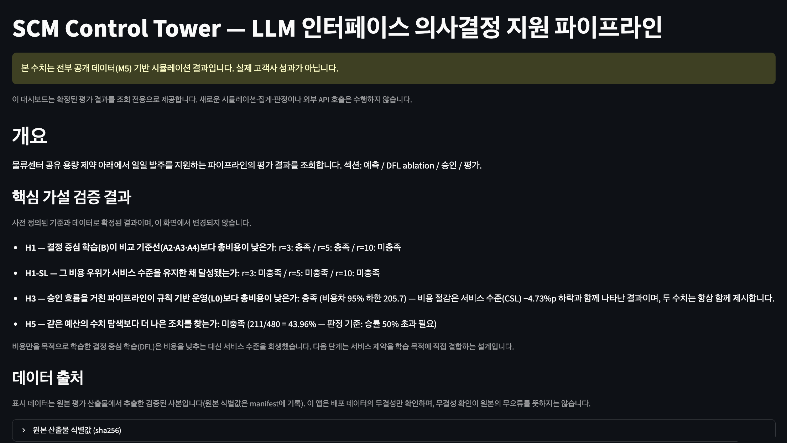
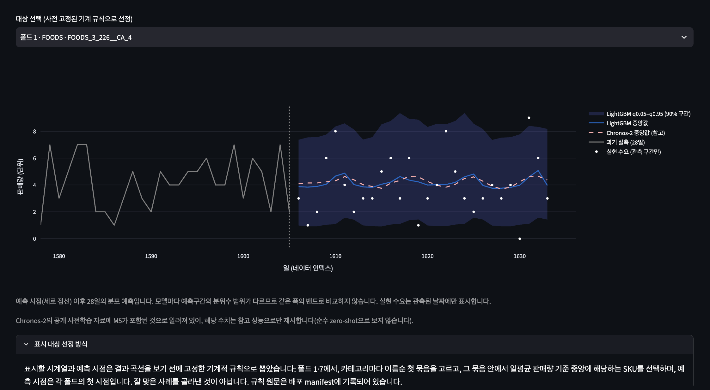

**English** · [한국어](README.ko.md)

# SCM Control Tower — LLM-Interfaced Decision-Support Pipeline

A pipeline supporting **daily order decisions** under shared distribution-center (DC) ordering capacity. It connects probabilistic demand forecasting, decision-focused learning, an automated validation gate for candidate actions, and a human approval flow into a single evaluation framework, with performance verified against pre-specified hypotheses and criteria.

> All figures in this repository are **simulation results** on public data (M5), not actual client outcomes.

**Dashboard**: https://control-tower-agent.streamlit.app · Run locally: `cd dashboard && streamlit run app.py`

## What the dashboard shows

| Section | Contents |
|---|---|
| Overview (개요) | Verdicts on the four core hypotheses, with data provenance (identifiers of the source artifacts) |
| Forecasting (예측) | Forecast quality by model (WQL · WAPE · MASE), realized coverage of prediction intervals, lead-time cumulative-demand intervals used as ordering inputs, and fan charts selected by a pre-set rule |
| DFL ablation | Cost–service coordinates of 9 policies plus the pipeline, paired confidence intervals against each baseline, and parallel verdicts on the cost (H1) and service (H1-SL) hypotheses |
| Approval (승인) | Role split in the human-approval flow, the H3 and H5 verdicts, and four representative cases from stored execution records (gate details, verbatim model explanations) |
| Evaluation (평가) | Operational outcome metrics (cost, service, inventory days), a financial bridge, and conditional scenario exploration under explicit γ·k assumptions |

The dashboard is read-only. Every figure is a verified copy extracted from artifacts finalized at evaluation time; no new simulation, aggregation, or adjudication happens in the app.

## The decision in scope

- **Target decision**: daily order quantities per SKU under shared ordering capacity at the bundle (U.S. state × department) level, committing the first day of a rolling 28-day plan (orders arrive on day 3)
- **Division of labor**: the pipeline takes over evidence collection → candidate-action generation and validation → drafting approval requests and explanations → post-adoption tracking; humans keep the definition of the action space, approval itself (demand planner, DC manager), execution, and rollback
- **Acceptance criteria (two layers)**: ① a statistical non-inferiority test on service level (CSL), ② an automatic gate blocking any case where bundle-week CSL falls below the 90% floor
- Cost coefficients, the service floor, and capacity levels used in evaluation are **virtual-client assumptions**, managed as a question list for a first client meeting

## Architecture

    Demand forecasting (LightGBM quantiles / TSMixer / adaptive interval calibration)
      → Order optimization (shared-capacity LP · decision-focused learning B)
      → Candidate-action generation (LLM interface) → capacity & service validation gate
      → Human approval → Simulator evaluation (12-fold rolling · 480 episodes/policy)

Evaluation runs on a purpose-built NumPy simulator that advances inventory, orders, and arrivals day by day. The engine follows a strict contract — constraint violations in policy output abort with an error instead of being silently repaired — and all policies share identical demand paths, initial states, and random seeds for paired comparison.

## Methodology at a glance

**Decision-focused learning (policy B)** — trains the forecasting model to directly reduce **downstream ordering cost** rather than forecast accuracy. The shared-capacity LP is attached to the neural network (TSMixer) as a differentiable layer (cvxpy + CvxpyLayers), so cost gradients of the 28-day ordering plan backpropagate into the forecast parameters. Common surrogate losses (the SPO+ family) were ruled out in advance as a theoretical mismatch with this problem's constraint structure, and LP solution degeneracy (multiple optima at equal cost) was controlled with SKU-specific cost coefficients.

**Comparison design** — each baseline controls a different question.

| Policy | Question it controls |
|---|---|
| A1 (point forecast + optimization) | How far is possible without distributional information |
| A2 (cost-weighted quantiles + optimization) | How far predict-then-optimize goes on the same neural backbone — the key control for H1 |
| A3 (quantile-scenario SAA) | Classical stochastic optimization with the distribution unrolled into scenarios |
| A4 / A4-SL (operational reorder policies) | Practical baselines — cost-selected and service-oriented |
| A-PTO (modeled on an external competition-winning approach) | A strong external predict-then-optimize reference |
| A5 (perfect information) | A reference bound with demand known in advance — not an attainable target |
| L0 (rule-based operations) | The virtual client's current playbook |

**Where the LLM sits** — the model never sets order quantities. It proposes parameter-adjustment candidates for the base policy (A4) and writes explanations; every candidate must pass the capacity–service validation gate, and when all candidates are rejected the base policy runs unchanged (27.1% of the 480 evaluation weeks). A total API spending cap was fixed in advance; actual spend was USD 1.10.

## Evaluation principles

- **Pre-specified hypotheses and criteria**: comparisons, verdict criteria, and failure rules were fixed in writing before any results were seen, and result-driven changes were prohibited. The evaluation subset was selected using only data from before the selection point, removing selection leakage
- **Statistics**: episodes (bundle × week) are not independent, so all verdicts use paired confidence intervals from a 2-week block bootstrap
- **Disclosure control**: results viewed early for diagnostics were never used to tune later stages; comparison settings were fixed and recorded before outcomes were seen
- **Record-keeping**: failed designs and rejected alternatives are documented as rigorously as successes

## Key results (pre-specified hypothesis tests)

| Hypothesis | Verdict |
|---|---|
| H1 — Does decision-focused learning (B) achieve lower total cost than the comparison baselines (A2 · A3 · A4)? | **Met** at r=3·5 / not met at r=10 |
| H1-SL — Is that cost advantage achieved while maintaining service level? | **Not met** under all conditions |
| H3 — Does the pipeline with its approval flow achieve lower total cost than rule-based operations (L0)? | **Met** (95% lower bound of the cost difference: 205.7) — alongside a −4.73pp drop in CSL |
| H5 — Does it find better actions than numeric search under the same budget? | **Not met** (211/480 = 43.96%) |

- Decision-focused learning trained on cost alone lowered cost at the expense of service level. The next design step is to build service constraints directly into the training objective.
- Following the H5 result, the system is designated a **decision-support pipeline assisting human approval** — not an autonomous "agent". The word *agent* left in the repository name reflects the hypothesis at the outset; the current designation reflects the verdict.
- L0 → pipeline comparison (r=5, 480 episodes): mean cost −18.77%, inventory days on hand −0.70 — these gains came **together with CSL −4.73pp and a +6.15pp worse quantity stockout rate**, and the cost saving is the net of holding −403.7 / stockout +182.7 / terminal valuation −19.6. Benefits are not read in isolation.
- Dollar (USD) figures are presented only as inventory-valuation effects derived through a holding-cost identity and as scenarios conditional on explicit assumptions (γ·k); no actual ROI is computed.

## Project journey

Behind the finished result are the decisions that changed its direction: rejecting the standard surrogate loss on theoretical grounds, finding selection leakage in the evaluation sample and re-drawing 127 of 154 SKUs, watching a preferred configuration get eliminated by rules set in advance, uncovering a flaw in the comparison design and rebuilding it, and renaming the system after a hypothesis was rejected. Fifteen such turning points are recorded in [DECISIONS.md](DECISIONS.md) (in Korean) — failed attempts written with the same weight as successes.

## Repository layout

    core_pipeline/
      data/        PostgreSQL 3-tier loading (raw/staging/mart), fold and cost tables
      simulator/   Daily NumPy engine (strict constraint contract, demand paths and shocks)
      forecast/    LightGBM quantiles · TSMixer · adaptive interval calibration · prediction store
      dfl/         Differentiable LP layer, training loop for decision-focused policy B
      agent/       Candidate generation (LLM interface) · validation gate · weekly runner
    scripts/       Runners for loading, mart build, evaluation, adjudication, dashboard data
    notebooks/     A-PTO baseline training (Colab GPU, input sha verification, budget-capped search)
    dashboard/     Read-only Streamlit dashboard (display data + integrity checks)
    tests/         Full test suite incl. simulator contract tests (T1–T7)

## Reproducing

The raw data (M5) is not included in the repository for size reasons; full pipeline reproduction requires acquiring it first (Kaggle). The dashboard runs immediately from the display data in the repository.

    python -m scripts.load_dataset --dataset m5   # PostgreSQL (docker-compose)
    python -m scripts.build_mart
    pytest                                        # includes simulator contract tests
    python -m scripts.run_stage6_eval             # policy evaluation
    python -m scripts.build_dashboard_snapshot    # dashboard display data
    python -m scripts.build_forecast_extract

Each step verifies the sha256 of its upstream artifacts; identifiers of the artifacts used in evaluation and adjudication are recorded in `dashboard/assets/display_manifest.json`.

## Limitations

- All gains are **simulation gains under an assumed cost function**; they do not reflect measured warehousing costs, cost of capital, or service penalties
- Demand is treated as exogenous, unaffected by policy — stockouts censoring demand observation is addressed only through a sensitivity grid
- The pipeline (LLM-path) result is a single execution path; settings and inputs are fixed for reproducibility, but model-output nondeterminism remains
- Interpreting the cost advantage of decision-focused learning is limited by asymmetric training exposure across baselines and by the gap between the training loss and rolling operating cost
- The M5 subset (10 bundles, 154 SKUs across foods, household, and hobbies) has limited seasonal and scale representativeness, and there is no verified evidence that operational metrics (latency, safeguard trigger rates) predict performance

## Tech stack

Python 3.11 · PostgreSQL (Docker) · NumPy simulator · LightGBM / PyTorch (TSMixer) · cvxpy + CvxpyLayers (differentiable optimization) · Anthropic API (candidate generation and explanations) · Streamlit (read-only dashboard) · paired evaluation via block bootstrap
